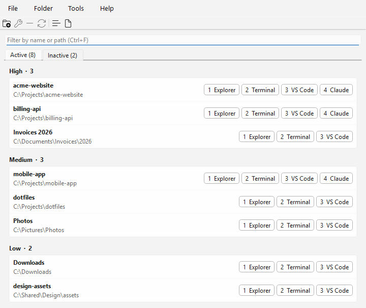
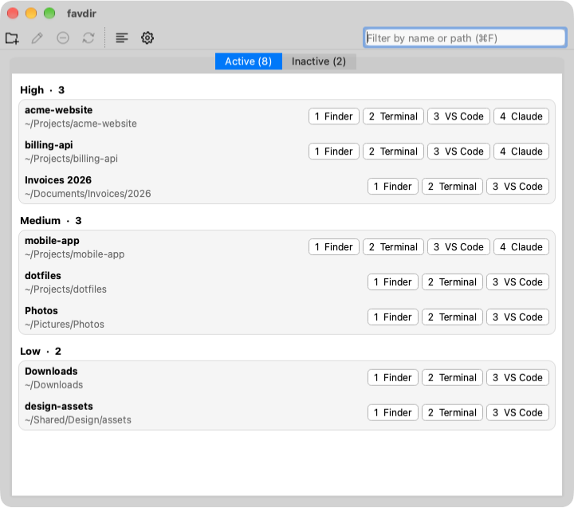

# favdir

A small desktop app that keeps a list of the folders you use most, and opens each one in the
tool you need with one click or one key. It runs on Windows and macOS.





- Folders sit in **High**, **Medium** and **Low** sections, on an **Active** and an
  **Inactive** tab. Move them between sections and tabs by dragging or with the keyboard.
- Each folder shows numbered **actions**. favdir starts with "Explorer" (or "Finder") and
  "Terminal"; add any command you like, such as Claude Code or VS Code. In a command,
  `{path}` and `{name}` are replaced by the folder's path and name. Actions come from a
  shared library, either on all folders or added to chosen ones, or belong to a single
  folder.
- Closing the window keeps favdir in the system tray (the menu bar on macOS, where it also
  leaves the Dock until the window shows again). A **global hotkey** shows or hides it from
  any application.
- Settings can **start favdir when you sign in** (on macOS 13 and later). It then starts
  hidden in the tray or menu bar.

## Keyboard

| Key | Effect |
|---|---|
| Alt+Shift+F (Windows), ⌃⌥F (macOS) | Show or hide favdir from anywhere; change it in Settings |
| Type | Filter by name or path |
| Down (in the filter) | Move into the list |
| Enter (in the filter) | Run the first action of the first match |
| Up, Down | Move through the folders, across sections |
| Enter | Run the first action |
| 1 to 9 | Run that action |
| Ctrl+1, Ctrl+2, Ctrl+3 | Move the folder to High, Medium or Low |
| Ctrl+Shift+Up, Ctrl+Shift+Down | Move the folder up or down in its section |
| Ctrl+I | Move the folder between Active and Inactive |
| Ctrl+Tab (⌃Tab on macOS) | Switch between Active and Inactive |
| Ctrl+N | Add a folder |
| Ctrl+C | Copy the folder's full path to the clipboard |
| F2 | Edit the folder and its actions |
| Delete | Remove the folder from the list (the folder itself is not touched) |
| Esc | Clear the filter, or hide the window |

On macOS, Ctrl in this table means ⌘, except where noted.

You can also drag folders from Explorer or Finder onto a section to add them.

## Actions

Actions live in the **action library** (Tools > Action library). Each library action is
either:

- **All folders**: it appears on every folder. A folder can hide it.
- **Optional**: it appears on no folder until you add it to one. Use this for tools that only
  some folders need, such as "Open in PyCharm" or "Run the dev server".

Reorder actions in either table by dragging a row, with Move up / Move down, or with
Ctrl+Shift+Up and Ctrl+Shift+Down. The buttons on a folder are numbered in this order:
library actions first, then the folder's own.

To show or hide library actions on one folder, press F2, or right-click the folder and use
**Library actions**. A folder can also have actions of its own, which no other folder sees.

Every action has:

- a **name**, shown on its button;
- a **command**, for example `code "{path}"`. Commands start in the folder. The command
  `@open` opens the folder in Explorer or Finder;
- a **Shell** option, which runs the command through `cmd /c` (Windows) or `/bin/sh -c`
  (macOS). Use it for scripts, `.cmd` files, pipes or `&&`.

On Windows, commands get the environment variables as they are set in Windows when the action
runs. A change to `PATH` therefore takes effect without restarting favdir.

The **Add** button in either table has templates for common commands. Each one asks for what
it needs and fills in an ordinary action, which you can then edit:

- **Open with application**: pick an app (`.app` on macOS, `.exe`, `.cmd` or `.bat` on
  Windows). On macOS this writes `open -na "/Applications/App.app" "{path}"`.
- **Terminal in folder**: Terminal on macOS; Windows Terminal (`wt -d "{path}"`) or `cmd` on
  Windows.
- **Terminal running a command**: opens a terminal in the folder and runs a command in it, such
  as `claude`. On Windows this writes `wt -d "{path}" cmd /k claude`; on macOS, an `osascript`
  command for Terminal.
- **iTerm in folder** and **iTerm running a command**: the same for iTerm2, shown on macOS
  when iTerm2 is in `/Applications` or `~/Applications`.
- **Run a command in the background**: a **Shell** command with no window, such as
  `./build.sh`.

When an action fails, the status bar shows why. A command that cannot start reports this at
once. A **Shell** command reports its exit code and error output when it exits with an error.
If the window is hidden, the message appears as a tray notification.

On Windows, the default Terminal action opens Windows Terminal (`wt -d "{path}"`) when it is
installed, and a classic `cmd` console otherwise. Windows Terminal ships with Windows 11 and is
a Microsoft Store app on Windows 10.

### Example actions

| Name | Windows command | macOS command | Shell |
|---|---|---|---|
| VS Code | `code "{path}"` | `open -a "Visual Studio Code" "{path}"` | Windows only |
| Git Bash | `"C:\Program Files\Git\git-bash.exe" --cd="{path}"` | | |

The templates above cover terminals and most applications. On Windows, `code` is a `.cmd`
script, so it needs **Shell**. On macOS, apps started from the Dock do not see your shell's
`PATH`, so `open -a` is more reliable than `code`.

## Data

Folders, actions and settings are saved as JSON:

- Windows: `%APPDATA%\favdir\favdir\favdir.json`
- macOS: `~/Library/Application Support/favdir/favdir/favdir.json`

The environment variable `FAVDIR_DATA_FILE` points favdir at another file, which is useful for
testing.

## Building

### What you need

| | Windows | macOS |
|---|---|---|
| Compiler | Visual Studio 2022 or its Build Tools, with "Desktop development with C++" | Xcode Command Line Tools (`xcode-select --install`) |
| Tools | CMake 3.25 or later | CMake 3.25 or later and Ninja (`brew install cmake ninja`) |
| Qt download | [uv](https://docs.astral.sh/uv/) | [uv](https://docs.astral.sh/uv/) |

### Steps

1. Download Qt. The script fetches the prebuilt Qt 6.8.3 base module (about 270 MB) into
   `.qt/` with [aqtinstall](https://github.com/miurahr/aqtinstall). It needs no Qt account and
   runs only once.

   ```sh
   scripts/setup.ps1     # Windows (PowerShell)
   sh scripts/setup.sh   # macOS
   ```

2. Configure, build and test. Use the preset `windows` or `macos`.

   ```sh
   cmake --preset windows
   cmake --build --preset windows
   ctest --preset windows
   ```

   The app is in `build/windows/bin/Release/favdir.exe`, or
   `build/macos/bin/Release/favdir.app`.

3. Package. This copies the app and the Qt libraries it needs into one folder. The prefix must
   be an absolute path.

   ```sh
   cmake --install build/windows --config Release --prefix "$PWD/dist"
   ```

The executable icon comes from `resources/favdir.ico` and `resources/favdir.icns`. Both are
generated from the drawing in `src/ui/Icons.cpp`; after changing it, rebuild them with
`cmake --build --preset windows --target make_icons`, then run
`build/windows/bin/Release/make_icons resources`.

The screenshots above are `docs/screenshot.png` (Windows) and `docs/screenshot-macos.png`
(macOS), drawn with made-up folders by the `make_screenshot` target. After changing the look of
the window, rebuild it with `cmake --build --preset windows --target make_screenshot`, then run
`build/windows/bin/Release/make_screenshot docs/screenshot.png`. On macOS, use the `macos`
preset and `docs/screenshot-macos.png`; the tool captures the window with `screencapture`, so
the terminal needs the Screen Recording permission.

### Tasks

`Taskfile.yml` wraps the steps above for [Task](https://taskfile.dev). Each task uses the
preset for the current platform. Run `task --list` to see them all.

```sh
task test         # download Qt if needed, configure, build and test
task run          # start favdir with a scratch data file in the build folder
task install      # copy the app and the Qt libraries into dist/
task package      # make the Windows setup or the macOS disk image
task icons        # regenerate the icon files
task screenshot   # regenerate the screenshot of the current platform
```

### Windows setup

With [NSIS](https://nsis.sourceforge.io/) installed, `cpack` builds `favdir-<version>-win64.exe`
from a Release build:

```sh
cd build/windows
cpack -C Release
```

The setup installs favdir with the Qt and Visual C++ runtime libraries it needs, adds a Start
menu entry, and on its last page offers to run favdir and to start it when you sign in. favdir
then starts hidden in the tray (`favdir --hidden`). The same option is in favdir's Settings.
When you install a new version over an old one, the sign-in option keeps its current setting.

### macOS disk image

`cpack` builds `favdir-<version>-macos.dmg` from a Release build:

```sh
cd build/macos
cpack -C Release
```

The disk image holds `favdir.app`, with the Qt libraries it needs, and a link to the
Applications folder. Drag the app onto the link to install it.

This disk image is signed ad hoc, not with an Apple Developer ID, and it is not notarised. The
first time you start a downloaded copy, macOS refuses to open it. Open System Settings > Privacy &
Security and click **Open Anyway** next to the message about favdir.

### Notarised macOS disk image

`scripts/release-macos.sh` builds a disk image that macOS opens without a warning. It runs on a
Mac with a "Developer ID Application" certificate in the keychain. It builds and tests favdir in
`build/macos-release`, signs the app and the disk image with the certificate, has Apple notarise
the disk image, and staples the notarisation ticket to it.

Store your notarisation credentials once. The password is an app-specific password from
[account.apple.com](https://account.apple.com):

```sh
xcrun notarytool store-credentials favdir --apple-id <Apple ID> --team-id <team ID>
```

Then build the disk image. `--upload` attaches it to the GitHub release `v<version>` and replaces
the one there:

```sh
sh scripts/release-macos.sh 1.0.0 --upload
```

### Releases

Pushing a tag `vX.Y.Z` runs the release workflow. It publishes a GitHub release for the tag,
builds and tests favdir with that version, then attaches the Windows setup and the notarised
macOS disk image to the release. The macOS job runs `scripts/release-macos.sh` with these secrets of the `release`
environment:

| Secret | Value |
|---|---|
| `MACOS_CERTIFICATE_P12` | The Developer ID Application certificate and its private key, exported as a `.p12` file, in base64 |
| `MACOS_CERTIFICATE_PASSWORD` | The password of the `.p12` file |
| `NOTARY_API_KEY` | The contents of an App Store Connect API key file (`AuthKey_<key ID>.p8`) |
| `NOTARY_API_KEY_ID` | The key ID of that API key |
| `NOTARY_API_ISSUER` | The issuer ID shown above the list of API keys in App Store Connect |

The environment accepts only `v*` tags and `master`, so other branches cannot use the secrets.

To change the Qt version, edit the version at the top of both setup scripts and in
`CMakePresets.json`.

## License

favdir is released under the [MIT License](LICENSE).

## Author

Rangel Reale (<realerangel@gmail.com>)
